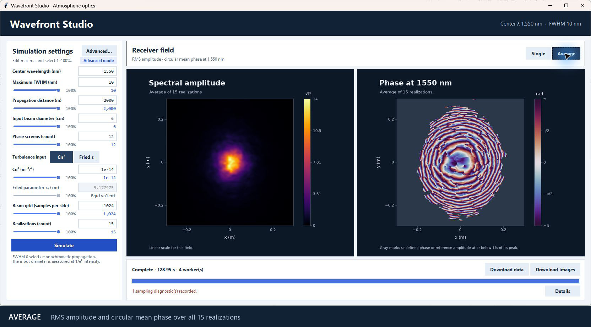
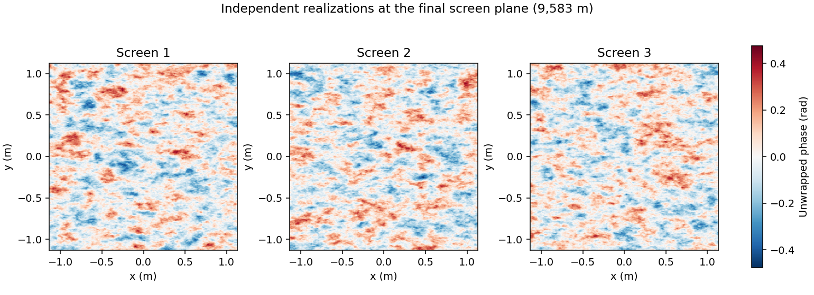
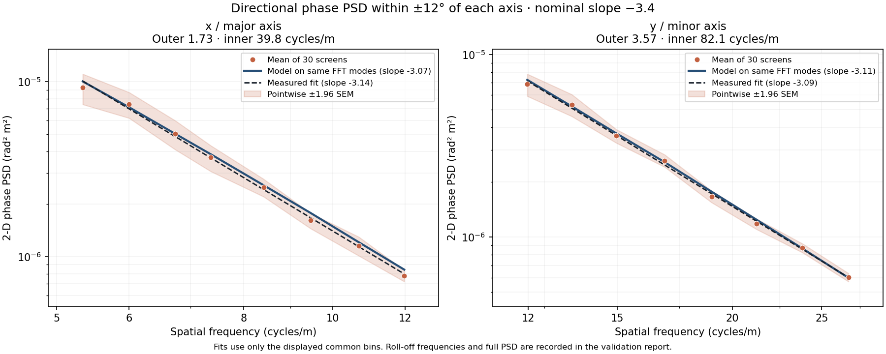
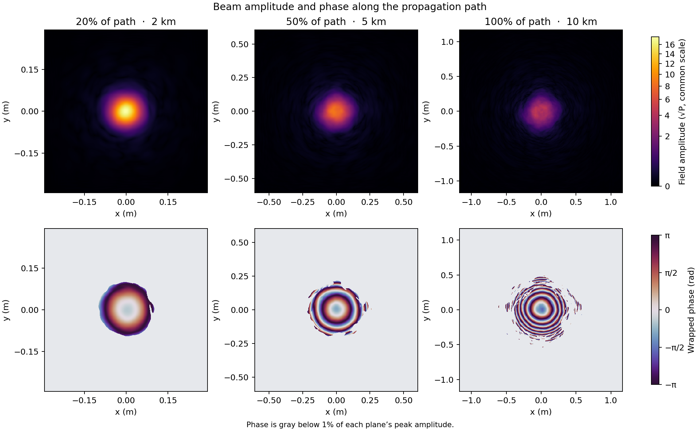

# Wavefront Studio

Wavefront Studio is a Python desktop app and simulation library for laser
propagation through atmospheric turbulence. Generate randomized phase screens,
propagate monochromatic or broadband Gaussian beams through multiple screens,
and inspect or export the receiver fields from an ensemble of independent runs.
The transverse simulation window grows with the beam along the path.

[](docs/wavefront-studio-demo.mp4)

[Watch the GUI demo (MP4)](docs/wavefront-studio-demo.mp4). The recording uses
window captures from a completed Advanced-mode run and shows the receiver
cycling through **Single** realizations and switching to **Average**. The
settings were a 2,000 m path, a 6 cm input beam, 12 screens, a
1,024 × 1,024 grid, 15 realizations, Cn² of 1 × 10⁻¹⁴ m⁻²⁄³, and a
1,550 nm center wavelength with 10 nm FWHM.

## Quick start

Use Python 3.10 or newer with Tkinter. From the repository directory, run:

```bash
python -m pip install -r requirements.txt
python gui.py
```

Set the propagation distance, beam diameter, phase-screen count, turbulence
strength, grid size, and number of realizations, then click **Simulate**. The
default run uses 10 km, a 6 cm beam, 12 phase screens, Cn² of 1 × 10⁻¹⁶ m⁻²⁄³,
a 512 × 512 grid, six realizations, a 1,550 nm center wavelength, and 10 nm FWHM.

| Control | How it works |
| --- | --- |
| Maximum values and sliders | Edit a maximum, then select 1–100% of it. Screen and realization counts are integers. The grid uses an even number of samples per side, at least 8. |
| Input beam diameter | Enter the initial 1/e² intensity diameter in cm. |
| Center wavelength and FWHM | Enter the center directly in nm and set the Gaussian bandwidth with the FWHM slider. Set maximum FWHM to zero for monochromatic propagation. |
| **Cn²** or **Fried r₀** | Select one editable turbulence input. The inactive field shows its equivalent using the current propagation distance and center wavelength. |
| **Single** or **Average** | Single cycles through receiver realizations every 0.3 s. Average displays the RMS receiver amplitude and circular mean phase across realizations. |
| **Details** | Review sampling diagnostics from the run. |

The amplitude colorbar uses **√P**, where P is local intensity on a
unit-launch-power scale. For broadband runs, P sums the wavelength-weighted
intensities. Average takes the square root of their mean across realizations.
The phase panel uses wrapped phase at the center wavelength and masks pixels
with weak reference signal. Use the colorbar values when comparing views,
since each amplitude image has its own display range.

## Advanced turbulence and validation

The default **Normal** setting uses an isotropic modified atmospheric
spectrum with Kolmogorov exponent 11/3, a 10 mm inner scale, and a 30,000 mm
outer scale. Open **Advanced…** to set a positive exponent α so the
inertial-range PSD scales as f⁻ᵅ. Set the maximum α and adjust its slider
within 3 < α < 4. The inner and outer scales are entered in mm, with the
inner scale smaller than the outer scale. Major and minor axis factors each
range from 0.5 to 2, with major ≥ minor. Turning off an axis factor sets it to 1.

Click **Validate** to generate 30 independent phase screens on the
final slab's grid at the center wavelength. The window displays the first
three unwrapped phase maps with a common colorbar.



The directional log–log PSD compares measured and model spectra on the same
FFT modes and fits the major and minor axes over their resolved inertial
ranges. Each panel lists the inner and outer roll-off frequencies in cycles/m.
**Enlarge PSD** opens the plot at a larger size. **Details** includes the full
sampled spectrum and identifies cutoffs beyond the grid's frequency range.



The dialog flags deviations from the model, insufficient fit coverage, or
out-of-band cutoffs. Use **Apply Advanced Setting** to run with the selected
spectrum or **Apply Normal Setting** to restore the default model.

The supplied [GUI validation report](gui_validation/advanced_gui_validation.json)
records 30 independent broadband realizations in each mode, button and input
checks, and both download archives. The
[directional PSD report](advanced_preview/advanced_validation.json) includes
fit bands, cutoff frequencies, and ensemble uncertainties.

## Download results

**Download data** saves a ZIP archive of NumPy arrays and a `manifest.json`
with settings, random seeds, wavelength samples, weights, and file descriptions.

| Path in the ZIP | Contents |
| --- | --- |
| `coordinates/` | Screen and receiver x/y coordinate matrices and screen z positions, in metres |
| `realization_NNNN/phase_screens_rad.npy` | Unwrapped screen phase at the center wavelength, indexed by screen, y, x |
| `realization_NNNN/after_screen_amplitude.npy` and `after_screen_phase_rad.npy` | Amplitude and center-wavelength phase immediately after each screen, indexed by screen, y, x |
| `realization_NNNN/final_amplitude.npy` and `final_phase_rad.npy` | Receiver amplitude and center-wavelength phase, indexed by y, x |
| `average/` | RMS receiver amplitude and circular mean phase over the ensemble |

Broadband exports also include `after_screen_center_amplitude.npy` and
`final_center_amplitude.npy` per realization. Combine center amplitude and
phase as `amplitude * np.exp(1j * phase)` to reconstruct the complex field at
the center wavelength. With zero FWHM, the standard amplitude arrays already
give the center amplitude. Coordinate arrays are float64, and field and
phase exports are float32.

**Download images** saves the receiver amplitude and phase PNGs for every
realization and the average in a separate ZIP. The app stages simulation arrays
on disk, so large ensembles and grids increase working storage. Save the ZIPs
before starting a new run or closing the app.

## Command-line examples

Run the 10 km example, which starts with a 3 cm waist radius and uses 40
independent midpoint screens on a 512 × 512 grid:

```bash
python demo.py
```

The default output directory is `results/`. It contains receiver and vacuum
fields, coordinates, saved diagnostics, and figures. Add `--save-screens` to
export every phase screen as an NPZ with its physical pitch and z position.
For example output, see the [phase screen](example_run/phase_screen.png),
[radial PSD](example_run/phase_spectrum.png), and
[channel summary](example_run/summary.json).



Use `--observation-distance 1000000` to compare Fraunhofer and Fresnel
observations 1,000 km beyond the receiver. The comparison uses the same
observation grid and saves both fields in `observation.npz`.

```bash
python validate.py
python validate_models.py
python validate_turbulence_modes.py --realizations 30
```

The demo and figure-producing validation commands plot by default. Use
`--plot False` or `--no-plot` to disable plotting. Their Python entry points
also accept `plot=False`. To regenerate figures from a saved run, use
`python plot_results.py --input results`.

## Python API

Generate one phase screen and propagate a broadband beam:

```python
import numpy as np

from phase_screens import Spectrum, randomized_phase_screen
from propagation import ChannelConfig, propagate_channel
from spectrum_band import gaussian_wavelengths

spectrum = Spectrum(cn2=1e-16, inner_scale=0.01, outer_scale=30.0)
phase_rad = randomized_phase_screen(
    n=512, dx=1e-3, wavelength=1550e-9, thickness=250.0,
    spectrum=spectrum, subharmonics=4, rng=np.random.default_rng(7),
)

config = ChannelConfig(
    wavelength=1550e-9, length=10_000, n_screens=40, n=512,
    waist=0.03, spectrum=spectrum, seed=7,
)
band = gaussian_wavelengths(wavelength_nm=1550, fwhm_nm=10)
result = propagate_channel(config, spectral_band=band)

receiver_intensity = result.intensity
receiver_center_field = result.field
```

Distances, wavelengths, and waist radii in the channel and screen APIs use
metres. The wavelength-band builder takes nanometres. Omit `spectral_band`
for a monochromatic run. Pass `snapshot_fractions=(0.2, 0.5, 1.0)` to obtain
complex snapshots at those path fractions as `(z_m, dx_m, field)` tuples.

| Module | Role |
| --- | --- |
| [gui.py](gui.py), [advanced_gui.py](advanced_gui.py) | Desktop controls, receiver display, and directional validation |
| [phase_screens.py](phase_screens.py), [advanced_turbulence.py](advanced_turbulence.py) | Randomized screens, spectra, subharmonics, and turbulence settings |
| [propagation.py](propagation.py), [spectrum_band.py](spectrum_band.py) | Scaled Fresnel steps, Fraunhofer observation, and Gaussian spectral sampling |
| [studio.py](studio.py), [studio_io.py](studio_io.py) | Parallel realizations, ensemble reduction, and downloads |

## Numerical method and scope

The phase-screen synthesis follows the shifted FFT lattice in Paulson, Wu, and
Davis. Each screen draws a shared random offset in each frequency direction
within one spectral cell. A spatial phase ramp restores that displacement
after the inverse FFT. Subharmonics sample the lowest-frequency cells.
The `CW comments:` annotations connect these steps and the propagation routines to
the manuscript. [Preprint](https://arxiv.org/abs/1905.07074v2)

Propagation uses a half Fresnel step, phase
modulation by `exp(1j * phi)`, and another half step for each slab. Each
slab receives a fresh screen on its physical grid. The scaled Fresnel FFT
handles the evolving physical window. Fraunhofer diffraction is available
for a downstream far-field observation, with a same-grid Fresnel comparison
to quantify the approximation. [Schmidt, *Numerical Simulation of Optical Wave Propagation with Examples in MATLAB*](https://doi.org/10.1117/3.866274)

Within each realization, all wavelengths share an optical-path screen.
The phase scales inversely with wavelength and each wavelength has a
separate Fresnel kernel. The default broadband quadrature uses nine
Gauss–Hermite samples of optical power per unit wavelength. Very broad
bands use 25 Gauss–Legendre samples over the positive-wavelength part of
the Gaussian. A common grid sizes the window using the longest sampled
wavelength. This is a spectrally integrated intensity model for scalar
paraxial optics with negligible refractive-index dispersion. A
time-resolved pulse requires a spectral-phase model.

<details>
<summary>Implementation choices and sampling checks</summary>

- The screen coefficient variance uses the spectral cell area, as in Eq. (4)
  of the preprint. The subharmonic amplitude scales as `3**(-p)` at level p,
  and the final draw covers the entire remaining central cell. The optional
  short-lag variance correction integrates outside the shifted FFT cells and
  uses the variance difference for its directional term.
  [Paulson dissertation, §2.7](https://doi.org/10.13016/081l-xgc6)
- Normal mode implements the modified atmospheric spectrum in Eqs. (9)–(10).
  Advanced mode combines finite scale cutoffs with the anisotropic spectrum
  in Eqs. (21)–(23). Its directional cutoff frequencies are
  `1/(mu*L0)` and `3.3/(2*pi*mu*l0)` in cycles/m. The GUI's Fried parameter
  is a uniform-path, plane-wave Kolmogorov equivalent evaluated at the center
  wavelength.
- Ensemble runs use independent random streams and up to four worker
  processes, limited by available cores, memory, and realizations. Samples
  are independent atmosphere draws. The playback interval is a display
  cadence.
- The screen method retains low-frequency tilt. FFT propagation still
  requires enough field of view and spatial resolution to control aliasing
  and boundary losses. Refine resolution, window width, screen spacing, and
  ensemble size for research calculations. Compare model and measured PSD
  over frequencies resolved by the grid. A wider window reaches lower
  spatial frequencies, while a finer pixel pitch reaches higher ones.
  [Schmidt, low-frequency sampling](https://schmidtwaveopticsbook.org/chapter9/subharmonicScreens.html)
- The [propagation checks](validation_results.json) compare analytic Gaussian
  beams, direct Fresnel integration, and a 400-screen Monte Carlo structure
  function. Additional results cover [other spectral models](model_validation_results.json),
  [broadband integration](spectral_validation.json), and
  [Normal and Advanced Monte Carlo tests](turbulence_modes_validation.json).
  Screen structure-function agreement verifies second-order phase statistics.
  Beam scintillation requires a separate check.
  [Schmidt, scintillation validation](https://schmidtwaveopticsbook.org/chapter9/verifyScintillation.html)

</details>

## Citation

If you use this work in research, cite Daniel A. Paulson, Chensheng Wu, and
Christopher C. Davis, “Randomized spectral sampling for efficient simulation
of laser propagation through optical turbulence,” *J. Opt. Soc. Am. B*
**36**, 3249–3262 (2019).
[DOI 10.1364/JOSAB.36.003249](https://doi.org/10.1364/JOSAB.36.003249)

Related references include Lane, Glindemann, and Dainty’s Kolmogorov subharmonic
method and Frehlich’s study of low spatial frequencies in split-step beam
propagation. [Lane et al.](https://doi.org/10.1088/0959-7174/2/3/003) ·
[Frehlich](https://doi.org/10.1364/AO.39.000393)

## License

See [LICENSE](LICENSE) for the repository's CC0 1.0 Universal terms.
